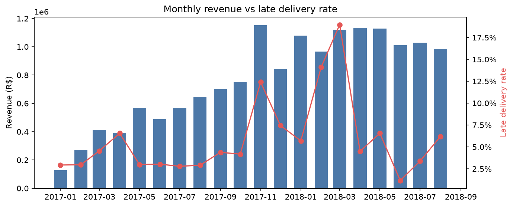
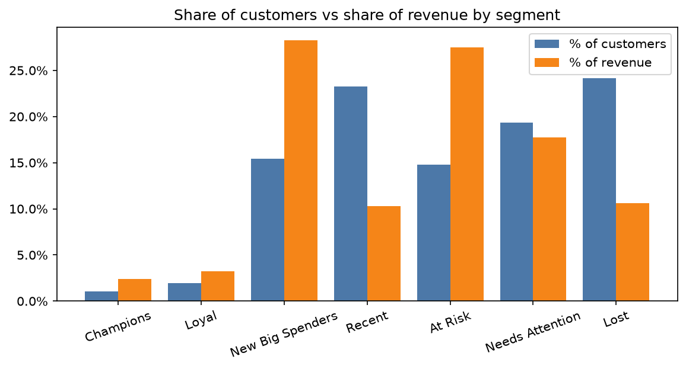
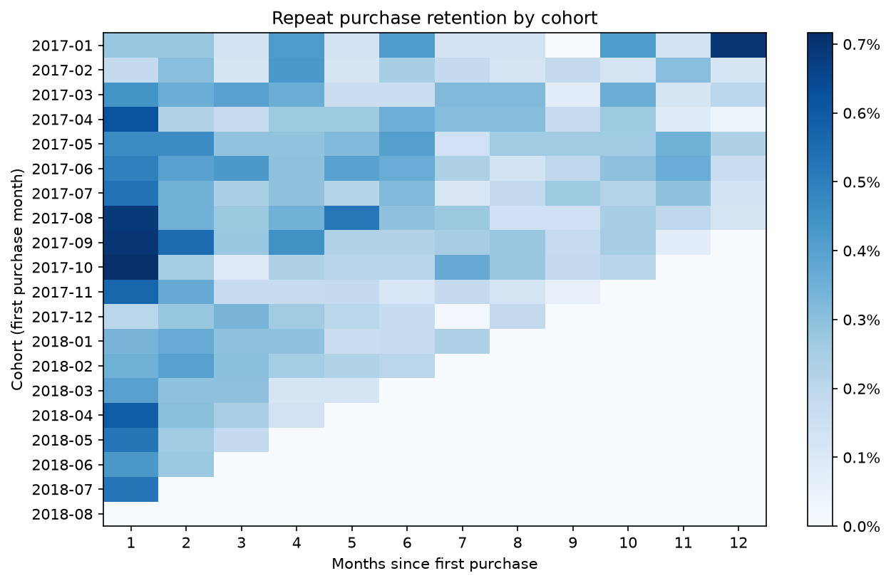
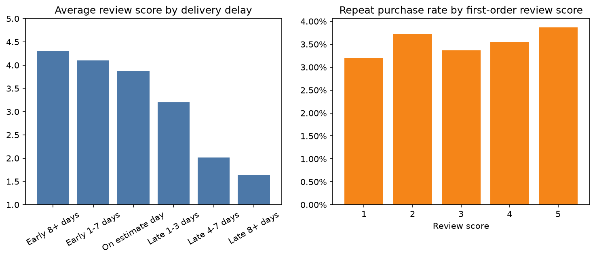

# Revenue at Risk: Why E-commerce Customers Don't Come Back

An end-to-end sales analytics project on 99k real orders from Olist, a Brazilian marketplace where 97% of customers never buy again.

**Business question:** Which customers are we losing, why, and how much revenue is at stake?

**Data:** [Olist Brazilian E-Commerce](https://www.kaggle.com/datasets/olistbr/brazilian-ecommerce): ~100k orders, 2016–2018, 8 related tables.

**Tools:** SQL (DuckDB / PostgreSQL) · Python (pandas, matplotlib) · Tableau

**Interactive dashboard:** _add your Tableau Public link here_

## Key findings
| Metric | Value |
|---|---|
| Revenue (delivered orders) | R$15.4M |
| Customers / orders | 93,358 / 96,478 |
| Average order value | R$159.83 |
| Repeat customer rate | **3.0%** |
| Late first deliveries | 7.8% |

1. **Late deliveries hurt satisfaction.** Late first orders average **2.16 stars** vs **4.26** for on-time orders.
2. **Unhappy customers don't return.** Customers whose first order was late come back **25% less often** (2.8% vs 3.8%).
3. **High-value customers are slipping away.** **13,779 "At Risk" customers** (high spend, no purchase in 1+ year) account for **R$4.2M, 27.5% of revenue**.
4. **Fixing delivery alone won't solve retention.** Removing late deliveries recovers only ~R$5k a year, because repeat rates are low even for on-time customers. The bigger opportunity is a second-purchase journey and winning back the At Risk segment.

## Recommendations
1. Improve carriers and delivery estimates in the states with the most late orders (AL, MA, CE).
2. Send an automatic apology and voucher when an order runs late, then A/B test the effect.
3. Run a personalised win-back campaign for the At Risk segment.
4. Track late rate, first-order review score and 90-day repeat rate monthly.

## Charts





## Project structure
| Step | File | What it does |
|---|---|---|
| 1 | `step1_explore.py` | Profiles raw data, finds data-quality traps |
| 2 | `sql/build_model.sql`, `step2_build_model.py` | Builds clean order and customer tables with SQL |
| 3 | `step3_kpis.py` | Headline KPIs and monthly trend |
| 4 | `step4_rfm.py` | RFM customer segmentation |
| 5 | `step5_cohorts.py` | Cohort retention analysis |
| 6 | `step6_root_cause.py` | Tests "late delivery → bad review → no repeat purchase" |
| 7 | `step7_revenue_at_risk.py` | Puts a money value on it and writes the executive summary |
| 8 | `step8_prepare_dashboard.py` | One flat file for the Tableau dashboard |

## How to run
1. Download the dataset from Kaggle and put the CSVs in `data/raw/`.
2. Run:
   ```bash
   python3 -m venv .venv && source .venv/bin/activate
   pip install -r requirements.txt
   python step1_explore.py   # ...then steps 2 to 8 in order
   ```

## Caveat
These findings show correlation, not proven causation. An A/B test would be needed before scaling any fix.
